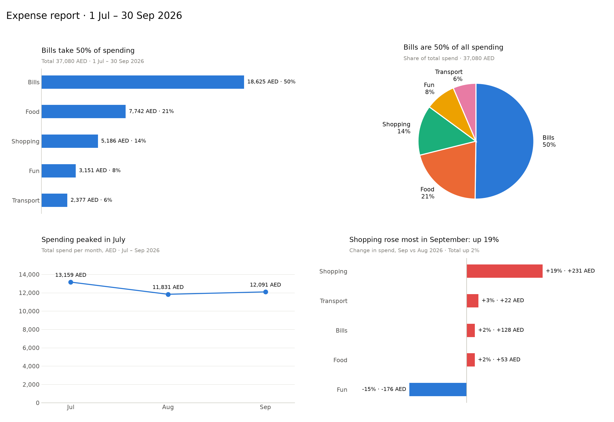
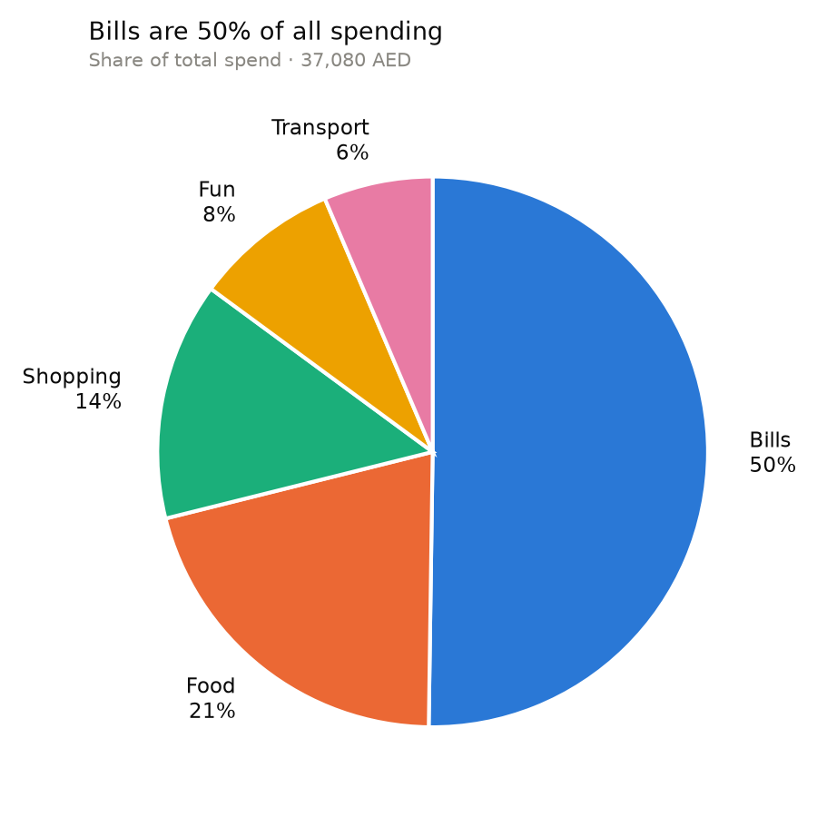

# Expense Analyzer

A small Python project that reads a CSV of daily expenses (in AED), prints a
spending summary, and saves charts — including a one-page report with every
chart on it.



## What it does

Running `analyze.py` prints:

- Total spent and average per day
- Total per category
- Top 5 single expenses
- Total per month
- This month vs last month, per category (e.g. `Shopping ... up 19%`)

and saves these charts:

| File | Chart |
|---|---|
| `category_chart.png` | Bar chart: total spend per category |
| `category_pie.png` | Pie chart: each category's share of spending |
| `monthly_chart.png` | Line chart: total spend per month |
| `month_change_chart.png` | Bar chart: % change per category since last month |
| `report.png` | All four charts on one page |

### Pie chart: category share



Each category keeps a fixed colour (set in `CATEGORY_COLORS` in
`analyze.py`), so its colour doesn't change if the spending order does.

## Setup

You need Python 3 (built with 3.13).

```bash
# 1. Create a virtual environment (an isolated folder for this project's packages)
python3 -m venv .venv

# 2. Activate it (macOS / Linux)
source .venv/bin/activate

# 3. Install the dependencies
pip install -r requirements.txt
```

## Usage

```bash
# Create sample_expenses.csv: 3 months (Jul–Sep 2026) of made-up expenses
python generate_sample_data.py

# Print the summary and save all the charts
python analyze.py
```

The sample data uses a fixed random seed, so it's the same every time you
generate it.

### Using your own data

Replace `sample_expenses.csv` with your own file using the same columns:

```csv
date,category,description,amount_aed
2026-07-01,Food,Lunch - office cafeteria,30.50
```

The month comparison needs at least two months of data. The pie chart's
colours are defined for the five sample categories (Bills, Food, Shopping,
Fun, Transport) — add any new category to `CATEGORY_COLORS`.

## Tests

```bash
python -m pytest
```

Tests live in `tests/test_analyze.py` and cover the monthly totals, top
expenses, month-to-month comparison, and that the report PNG is created.

## Project structure

```
expense-analyzer/
├── analyze.py               # summary + charts
├── generate_sample_data.py  # creates sample_expenses.csv
├── sample_expenses.csv      # sample data
├── requirements.txt         # pinned dependencies
├── tests/
│   └── test_analyze.py
└── *.png                    # generated charts
```
